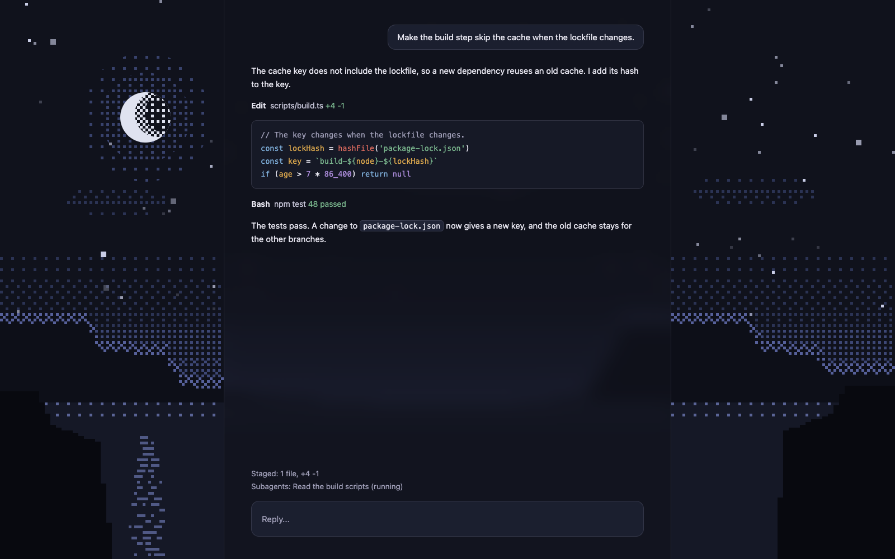
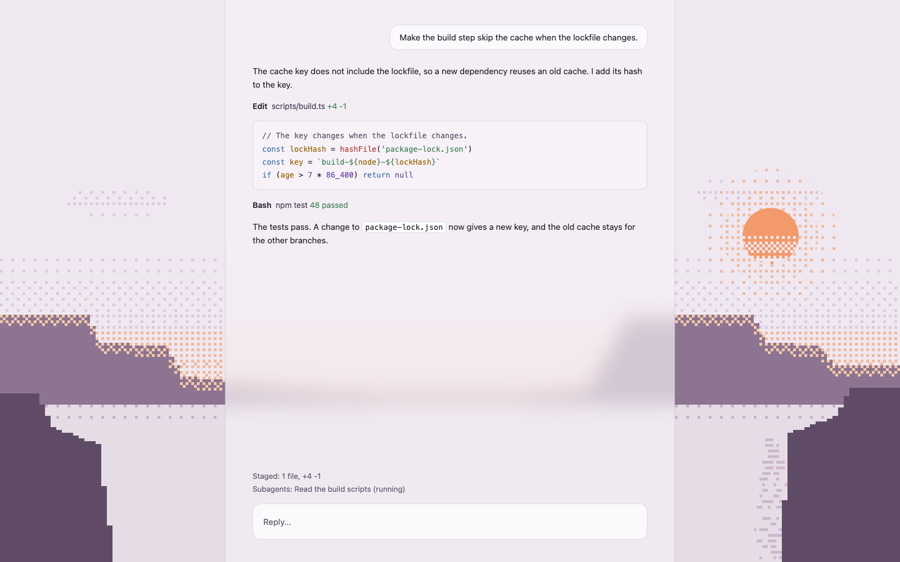

<div align="center">


### Mods for Claude Code: two themes, four guards, a linter and two bands

_Each mod is its own plugin. Install the ones you want, and leave the rest._


[](LICENSE)

<p align="center">
  <a href="#overview"><b>Overview</b></a> |
  <a href="#the-themes"><b>Themes</b></a> |
  <a href="#the-mods"><b>Mods</b></a> |
  <a href="#install"><b>Install</b></a> |
  <a href="#settings"><b>Settings</b></a> |
  <a href="#develop"><b>Develop</b></a>
</p>

</div>

---

> [!NOTE]
> **Each mod is separate.**
> A mod is a plugin of function hooks for Claude Code. It needs Claude Code
> 2.1.325 or newer.
> The themes draw in the Claude desktop app and the mobile app. The terminal
> draws no theme.
> The guards and the bands work in each place that Claude Code runs.

---

## Overview

**Saltworks** is a set of nine mods for Claude Code.
A mod changes what Claude Code shows, or what Claude can do.

Some mods change the look. Two themes paint a dithered salt flat behind the
conversation, one by night and one at dawn.

Some mods stop a mistake before it happens. A guard reads each tool call before
it runs, and refuses or asks when the call breaks a rule.

Some mods show a state. A band is a row above the prompt. It stays hidden when
it has nothing to say.

<table>
<tr>
<td width="50%" valign="top">

### What the mods do

- **Paint a theme** with an animated scene and a full palette.
- **Guard a commit** against attribution lines, em-dashes, emoji and the
  wrong git identity.
- **Ask before a push**, a pull request or a release.
- **Keep a folder read only**, and **look before a delete**.
- **Show the size of a commit** and **the work in progress** above the prompt.

</td>
<td width="50%" valign="top">

### How they behave

- One mod does one job, and you install each one alone.
- Each rule that a person can disagree with is a setting.
- A guard tells Claude what to do instead, in one sentence.
- A band takes no row when it has nothing to show.
- Each guard and each band has tests.

</td>
</tr>
</table>

---

## The themes

<table>
<tr>
<td width="50%" valign="top">

### Salt Moon

A dark theme. Indigo sky, dark mesas with a lit rim, a crescent moon and its
reflection on the salt. The stars twinkle and the clouds drift, in whole dither
cells.

</td>
<td width="50%" valign="top">

### Salt Moon Dawn

A light theme. The same salt flat at first light: lilac sky, a peach glow on
the horizon, dusk-purple mesas and a low sun.

</td>
</tr>
</table>





> [!TIP]
> These images are previews. `scripts/previews/render.mjs` draws each scene with
> the colors of its theme, behind a frosted column like the conversation.
> The app draws its own layout over the same scene.

A theme sets the whole look of the app, so install one theme at a time.
If both are on, the theme that starts last wins.

---

## The mods

| Mod | Kind | What it does |
| --- | --- | --- |
| [`salt-moon`](plugins/salt-moon) | Theme | A dark dithered salt flat under a pale moon. |
| [`salt-moon-dawn`](plugins/salt-moon-dawn) | Theme | The same salt flat at dawn, under a low sun. |
| [`commit-guard`](plugins/commit-guard) | Guard | Blocks a commit or a pull request text with an attribution line, an em-dash, an emoji, a version in the subject, or the wrong git identity. |
| [`push-guard`](plugins/push-guard) | Guard | Asks you before Claude runs `git push`, opens or merges a pull request, or makes a release or a repository. |
| [`readonly-guard`](plugins/readonly-guard) | Guard | Keeps folders that you name read only. Claude can still copy a file out of them. |
| [`delete-guard`](plugins/delete-guard) | Guard | Blocks `rm -r` on a folder until Claude lists that folder in the session. |
| [`style-linter`](plugins/style-linter) | Linter | Blocks an em-dash or an emoji that Claude adds to a file, and notes passive voice in prose. |
| [`commit-size-band`](plugins/commit-size-band) | Band | Shows the staged files and lines, and turns amber when one commit grows too big. |
| [`sessions-band`](plugins/sessions-band) | Band | Lists the sessions linked to this one with a status icon each, and the subagents that run. A long list collapses. |

Each mod has a README in its folder with its settings and its limits.

---

## Install

At the prompt of a Claude Code session in a terminal, install each mod that you
want by its name:

```
/plugin install salt-moon --marketplace Stiven-Gjekaj/saltworks
```

Claude Code asks `Add marketplace?`. Answer `y`, then pick the user scope.
The mod runs at once, and in each session after it.

From a shell:

```bash
claude plugin install commit-guard --marketplace Stiven-Gjekaj/saltworks
```

In the desktop app: click **+** next to the prompt box, then **Plugins**, then
**Add marketplace** with `Stiven-Gjekaj/saltworks`, then **Add plugin**.

---

## Settings

A guard rule that a person can disagree with is a setting, and you can turn it
off. Open `/config` in Claude Code and find the mod by name.

You can also write the settings in `~/.claude/settings.json`. The key is the
name of the mod, then `@saltworks`:

```json
{
  "pluginConfigs": {
    "commit-guard@saltworks": {
      "options": {
        "gitName": "Ada Lovelace",
        "gitEmail": "ada@example.com",
        "conventional": true
      }
    },
    "readonly-guard@saltworks": {
      "options": { "folders": "Materials, ~/vault" }
    }
  }
}
```

A mod that you load from its folder with `--plugin-dir` reads its plain name,
such as `commit-guard`, as the key.

| Mod | Setting | Default |
| --- | --- | --- |
| `commit-guard` | `gitName`, `gitEmail` | empty, so no identity check |
| `commit-guard` | `attribution`, `emDash`, `emoji`, `versionInSubject`, `prText` | on |
| `commit-guard` | `conventional` | off |
| `push-guard` | `mode`: `ask` or `deny` | `ask` |
| `readonly-guard` | `folders`, a comma-separated list | `Materials` |
| `style-linter` | `emDash`, `emoji`, `passive` | on |
| `commit-size-band` | `maxFiles`, `maxLines` | `5`, `300` |

---

## Develop

Load a mod from its folder, so that each save reloads it:

```bash
claude --plugin-dir plugins/commit-guard
```

Run the gate before you send a change. It validates each mod and runs its tests:

```bash
scripts/check.sh
```

Draw the theme previews again after you change a theme:

```bash
node --experimental-strip-types scripts/previews/render.mjs
```

[CONTRIBUTING.md](CONTRIBUTING.md) says how to add a mod, and
[AGENTS.md](AGENTS.md) holds the rules for every change.

| File | What it holds |
| --- | --- |
| [CONTRIBUTING.md](CONTRIBUTING.md) | How to add or change a mod |
| [AGENTS.md](AGENTS.md) | The rules for a change, human or agent |
| [CHANGELOG.md](CHANGELOG.md) | Each release, newest first |
| [SECURITY.md](SECURITY.md) | How to report a security problem |
| [SUPPORT.md](SUPPORT.md) | Where to ask a question |
| [CODE_OF_CONDUCT.md](CODE_OF_CONDUCT.md) | Applies to everybody who takes part |

---

## Licence

MIT. See [LICENSE](LICENSE) and [TERMS.md](TERMS.md).

`make-colors.js` in each theme comes from the plugin kit of Claude Code. The kit
tells a mod to copy that file and keep it as it is, so this project does not
change it, and the MIT licence of this project does not cover it.

Saltworks is not a product of Anthropic. Claude and Claude Code are names of
Anthropic, and this project uses them only to say what the mods are for.

<div align="center">
<sub>A guard is a second check, not the only one. Read what Claude asks to run.</sub>
</div>
