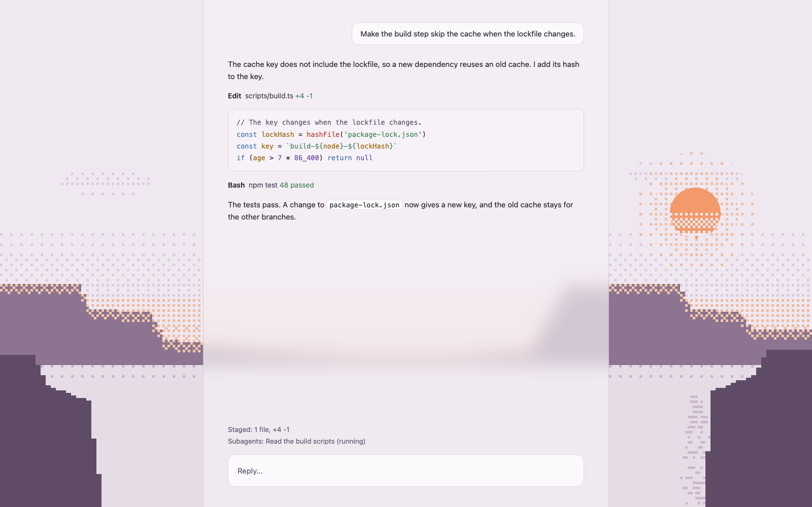

<div align="center">
  <a href="../../README.md"><b>Saltworks</b></a>
</div>

# Salt Moon Dawn

A light theme for the Claude desktop app and the mobile app.

## Install

At the prompt of a Claude Code session in a terminal:

```
/plugin install salt-moon-dawn --marketplace Stiven-Gjekaj/saltworks
```

Answer `y` to add the marketplace, then pick the user scope.



## What it does

- Paints the salt flat of `salt-moon` at first light: a lilac sky, a peach glow
  on the horizon, dusk-purple mesas, and a low sun with its reflection.
- Moves slowly. The halo breathes and the clouds drift one dither cell at a
  time. A system setting for reduced motion stops it.
- Sets a full light palette. The grays take the hue of the morning sky, and
  red, green and amber keep their meaning.

## Limits

- The terminal and the editors draw no theme.
- A theme sets the whole look. Install one theme at a time. If two are on, the
  one that starts last wins.
- The theme is for light mode only. Its twin, `salt-moon`, is for dark mode.
