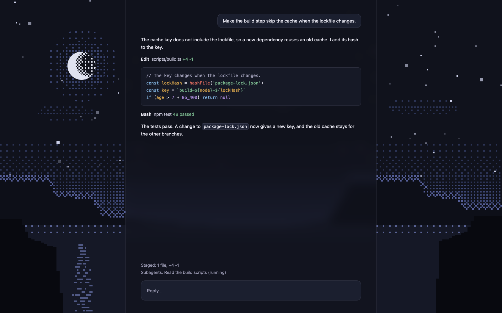

<div align="center">
  <a href="../../README.md"><b>Saltworks</b></a>
</div>

# Salt Moon

A dark theme for the Claude desktop app and the mobile app.

## Install

At the prompt of a Claude Code session in a terminal:

```
/plugin install salt-moon --marketplace Stiven-Gjekaj/saltworks
```

Answer `y` to add the marketplace, then pick the user scope.



## What it does

- Paints a dithered salt flat behind the conversation: an indigo sky, dark mesas
  with a lit rim, a crescent moon, and its reflection on the salt.
- Moves slowly. The stars twinkle, the halo breathes, and the clouds drift one
  dither cell at a time. A system setting for reduced motion stops all of it.
- Sets a full dark palette. The grays take the hue of the sky, and red, green
  and amber keep their meaning.

## Limits

- The terminal and the editors draw no theme.
- A theme sets the whole look. Install one theme at a time. If two are on, the
  one that starts last wins.
- The theme is for dark mode only. Its twin, `salt-moon-dawn`, is for light
  mode.
